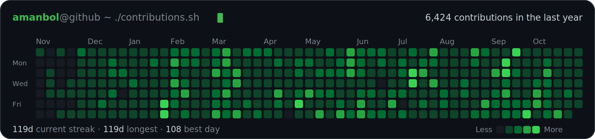

<h3><code>amanbol@github ~ $ ./contributions.sh</code></h3>

  

<h3><code>amanbol@github ~ $ whoami</code></h3>

<table>
  <tr>
    <td valign="top"></td>
    <td valign="top"></td>
  </tr>
</table>

 

<h3><code>amanbol@github ~ $ cat experience.txt</code></h3>

<b>Fullstack Developer · QA Engineer</b> 
PrimeTech Group · Frontend development and QA for a cryptocurrency exchange and exchange service. 
Approximately 6 months of QA experience, including functional and regression testing before releases.

<a href="./RESUME.md">Read my resume</a> · <a href="https://amanch1ik.github.io/Portfolio_Amanchik/resources/resume.pdf">Download CV (PDF)</a>

 

<h3><code>amanbol@github ~ $ ls ./projects</code></h3>

<!-- PROJECTS:START -->

<table width="100%">
<tr>
<td width="50%" valign="top" height="130">
  <b>Course Platform</b> 
EdTech · Contributor · 2026  
   
</td>
<td width="50%" valign="top" height="130">
 <b>Aiden Voice Assistant</b> 
AI / Voice Assistant · Author · 2026  
   
</td>
</tr>
<tr>
<td width="50%" valign="top" height="130">
 <b>MMORPG Telegram Bot</b> 
Game / Telegram · Author · 2025-2026  
  
</td>
<td width="50%" valign="top" height="130">
 <b>Reklama AI Generator</b> 
AI / SaaS · Author · 2025-2026  
   
</td>
</tr>
<tr>
<td width="50%" valign="top" height="130">
 <b>Face Emotion Detection</b> 
AI / Computer Vision · Author · 2025-2026  
  
</td>
<td width="50%" valign="top" height="130">
 <b>SilkRoute AI Agent</b> 
AI / Agents · Author · 2026  
 
</td>
</tr>
<tr>
<td width="50%" valign="top" height="130">
 <b>Yess!Go Backend</b> 
Mobility / Backend · Author · 2025-2026  
  
</td>
<td width="50%" valign="top" height="130">
 <b>Yess!Go Web App</b> 
Mobility / Frontend · Author · 2025-2026  
  
</td>
</tr>
<tr>
<td width="50%" valign="top" height="130">
  <b>Yess!Go Mobile App</b> 
Mobility / Mobile · Contributor · 2025-2026  
  
</td>
<td width="50%" valign="top" height="130">
 <b>Yess.MauiApp</b> 
Mobility / Mobile · Contributor · 2025  
   
 
</td>
</tr>
<tr>
<td width="50%" valign="top" height="130">
 <b>Yess-go-v2</b> 
Mobility / Backend · Contributor · 2025  
  
 
</td>
<td width="50%" valign="top" height="130">
  <b>PrimeTech Admin Panel</b> 
Admin Panel · Contributor · 2025-2026  
  
</td>
</tr>
<tr>
<td width="50%" valign="top" height="130">
  <b>PrimeTech User Web</b> 
Web App · Contributor · 2025-2026  
  
</td>
<td width="50%" valign="top" height="130">
 <b>Ads Launcher</b> 
Marketing Tools · Author · 2025-2026  
 
</td>
</tr>
<tr>
<td width="50%" valign="top" height="130">
 <b>Automation &amp; Attendance Scripts</b> 
Automation / Telegram · Author · 2025-2026  
  
</td>
<td width="50%" height="130"></td>
</tr>
</table>

<!-- PROJECTS:END -->

 

<h3><code>amanbol@github ~ $ ./snake.sh</code></h3>

<picture>
  <source media="(prefers-color-scheme: dark)" srcset="https://raw.githubusercontent.com/Amanch1ik/Amanch1ik/output/github-snake-dark.svg" />
  <source media="(prefers-color-scheme: light)" srcset="https://raw.githubusercontent.com/Amanch1ik/Amanch1ik/output/github-snake.svg" />
  
</picture>

  

<h3><code>amanbol@github ~ $ ./connect.sh</code></h3>

  

<code>~ built with SVG + a daily GitHub Action · no trackers, no tokens ~</code>

